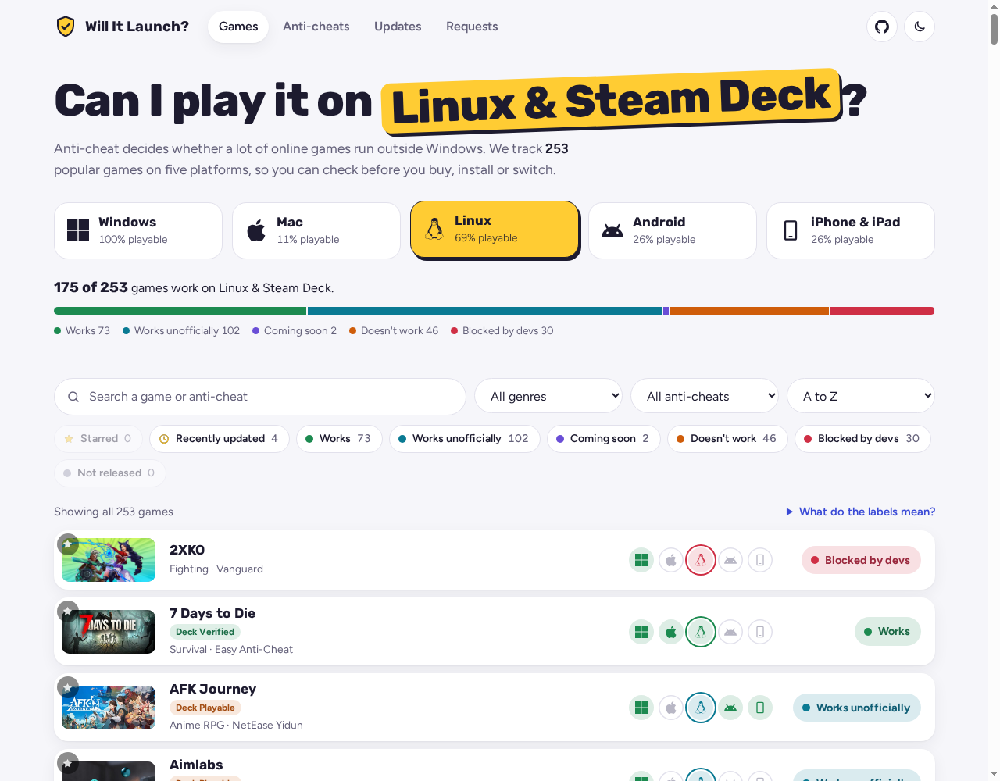
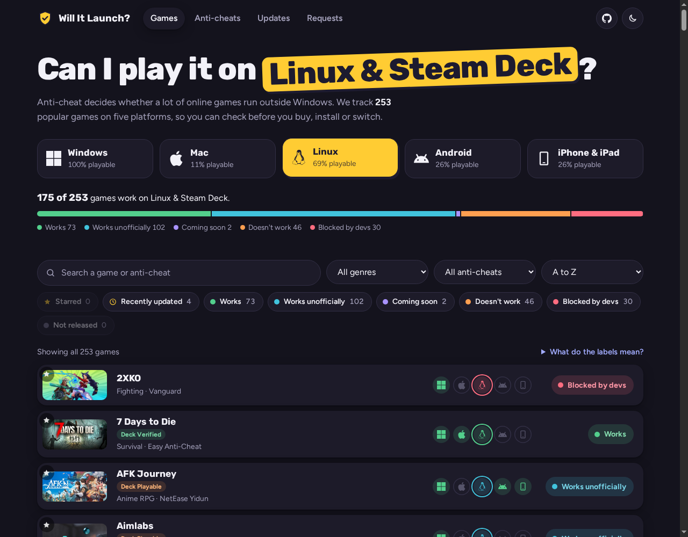

# Will It Launch?

**Can I play it on Linux, Steam Deck, Mac or my phone?**

Anti-cheat decides whether a lot of online games run outside Windows. Will It Launch? tracks 230+ popular online games on five platforms (Windows, Mac, Linux & Steam Deck, Android, iPhone & iPad) so you can check before you buy, install or switch.

**Try it: https://retroul.github.io/will-it-launch/**

| Light | Dark |
| --- | --- |
|  |  |

## Features

- **Pick your platform** and see how many games work there, in plain words: *Works*, *Works unofficially*, *Coming soon*, *Doesn't work*, *Blocked by devs*.
- **Every platform at a glance** for each game, with cover art, notes, links (Steam, ProtonDB, SteamDB) and a Linux timeline.
- **Search and filter** by name, genre, anti-cheat or status, and sort by what works best.
- **Anti-cheat breakdown**: how Easy Anti-Cheat, BattlEye, Vanguard and 40+ others behave on each platform.
- **Steam Deck and ProtonDB ratings** for every Steam game.
- **Updates page and RSS feed** ([feed.xml](feed.xml)) with the latest anti-cheat news and status changes.
- **Star your games** to keep them at the top, and **share** a direct link to any game.
- **Install it like an app** and use it offline.
- **Game requests with voting**, anonymous, one vote per connection, with a Cloudflare bot check and a speed limit.
- Light and dark themes, works on phones, no build step.
- **Private by design**: no accounts, cookies, analytics or tracking, and a strict Content Security Policy. See [SECURITY.md](SECURITY.md).

## Help out

You don't need to code to help:

- [Request a game](../../issues/new?template=game-request.yml), or give a 👍 to [existing requests](../../issues?q=is%3Aissue+is%3Aopen+%22%5BRequest%5D%22+in%3Atitle+sort%3Areactions-%2B1-desc).
- [Report a wrong status](../../issues/new?template=status-report.yml) if a game changed.

## For developers: run your own copy

The sections below are for people who want to run or change the code themselves.

### Run it locally

It's plain HTML, CSS and JavaScript. Open `index.html` in a browser, or serve the folder:

```sh
python3 -m http.server
```

### Publish your own copy on GitHub Pages

1. Push this folder to a GitHub repository.
2. **Settings → Pages → Build and deployment**: deploy from the `main` branch, `/ (root)`.
3. Your site appears at `https://<your-name>.github.io/<repo>/`.

The "Request a game" and "Something wrong? Tell us" links find your repository automatically on GitHub Pages. On a custom domain, set `repo` in `config.js`.

### Game requests and voting

> **Already set up on [the official site](https://retroul.github.io/will-it-launch/#requests).** Visitors can request and vote there now. The options below only matter if you run your own copy.

There are two options:

- **GitHub only (default).** The Requests page links to an issue form. People vote with 👍 on requests, one vote per GitHub account.
- **Anonymous votes on the site.** Deploy the small [vote server](vote-server/README.md) (free Cloudflare Worker) and put its address in `config.js` as `voteApi`. Anyone can then request and vote without an account. Votes are limited to one per IP, and IPs are never stored, only a keyed hash.

## Where the data comes from

| What | Source |
| --- | --- |
| Linux & Steam Deck status, anti-cheat names, notes, timeline | [Are We Anti-Cheat Yet?](https://areweanticheatyet.com) ([GitHub](https://github.com/AreWeAntiCheatYet/AreWeAntiCheatYet), MIT) |
| Mac availability | Steam store data plus manual checks |
| Windows, Android, iOS availability | Maintained by hand in `tools/update_data.py` |
| Cover art | Steam store images; for games not on Steam, official share images, App Store screenshots or Wikipedia, saved in `images/covers/` |

A GitHub Action (`.github/workflows/update-data.yml`) pulls the latest Linux data every Monday and commits it if anything changed. To run it yourself:

```sh
python3 tools/update_data.py
```

### Add or fix a game

1. Open `tools/update_data.py` and add a line to `GAMES`, for example:
   ```python
   G("Deep Rock Galactic", "Shooter", mac="U", android="U", ios="U"),
   ```
   The first value must match the game's name in the [upstream list](https://github.com/AreWeAntiCheatYet/AreWeAntiCheatYet/blob/master/games.json). Platform codes: `S` works, `R` works unofficially, `P` coming soon, `B` doesn't work, `D` blocked by devs, `U` not released. Add a note with a tuple: `android=("S", "Separate game: X Mobile")`.
2. Run `python3 tools/update_data.py`.
3. Open a pull request.

### Project layout

```
index.html          page
styles.css          design
app.js              filtering, sorting, views, requests
config.js           optional settings (repo, vote server)
data/games.js       generated game data (don't edit by hand)
tools/update_data.py  builds data/games.js
vote-server/        optional Cloudflare Worker for anonymous voting
```

## License

MIT. Linux data © Are We Anti-Cheat Yet contributors (MIT). Platform icons from [Simple Icons](https://simpleicons.org) (CC0). Game names and artwork belong to their owners. This project isn't affiliated with any game studio or anti-cheat company.
